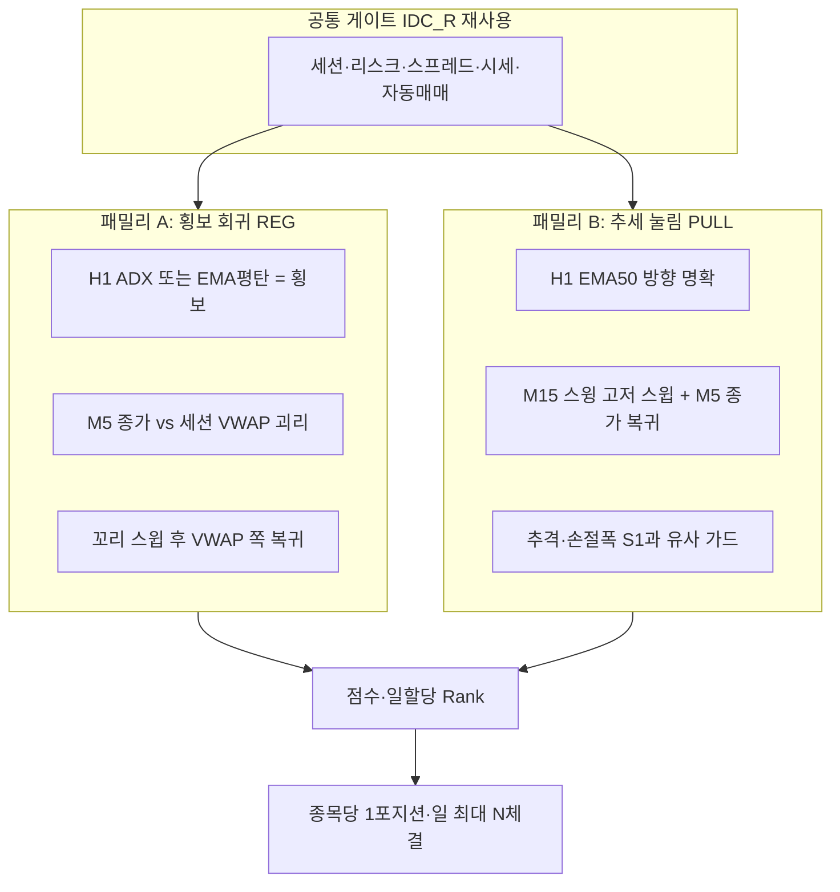

# IDC_V2 설계서 (초안 v0.1)

**전제**: `docs/EA_V2_PURPOSE.md`의 목적·KPI. S1 폐기, IDC_R 동결.

**가칭 EA**: `IDC_V2` · 헌법 `IDC_V2_CONSTITUTION.txt` (미작성 → 구현 PR에서 동시 제출)

---

## 1. 설계 목표 요약

| 항목 | V2 목표 |
|---|---|
| 일 체결 | 설계 기대 **2.2~2.8회/세션일** (선택표 S3 2.0 + α) |
| 월 소득 | 중앙 **300만 이상** 유지 노력 (시뮬·포워드로 재산정) |
| 승률·RR | 1차 목표: 승률 **50~55%**, RR **1.3~1.6** (빈도형) |
| FTMO | 기존 IDC_R 게이트 **재사용** (세션·손실·스프레드·랏) |

---

## 2. 핵심 아이디어: 이중 패턴 + 포트폴리오 빈도

하루 2건을 **단일 패턴(S1)** 으로는 구조적으로 부족합니다. V2는 **서로 다른 두 신호 패밀리**를 **항상 동시에** 켭니다.

- **REG (회귀)**: 선택표 **S3** 계열. H1이 **추세가 아닐 때만** 활성. VWAP(세션 누적 또는 일중 앵커)에서 **통계적 이탈 후 복귀**.  
- **PULL (눌림)**: 선택표 **S2** 축소판. 강한 M15 바 이후 **첫 M5 눌림**. S1보다 H1 **기울기 3봉 조건 완화**(방향 일치만) → 빈도 ↑, 별도 점수 커트로 품질 유지.

두 패밀리는 **동시에 후보를 생성**하므로, 단일 종목·단일 레벨 재흡수 대비 **일 후보 수 ~2.5배** 설계.

---

## 3. 빈도 KPI를 위한 운영 규칙 (품질 붕괴 방지)

| 규칙 | 설명 |
|---|---|
| **일 체결 상한** | 기본 **4건** (2건 KPI + 과다 방지). 학습 후 점수로 **3~5** 조정 가능 |
| **일 체결 하한 대응** | **인위 진입 금지**. 대신 **19:30 KST** 시점 체결 0건이면 **REG만** 스프레드·괴리 임계 **B-set**(헌법에 수치 고정) 활성 — 여전히 REG 정의 충족 필수 |
| **종목** | 기본 **XAUUSD, US100, US30, US500** (4종). 골드·지수 동시 스캔 |
| **포지션** | **종목당 1**. 청산 후 **동일 종목 재진입 허용** (S1은 청산 전 금지 동일) → 하루 2건 달성률 ↑ |
| **동시 보유** | 최대 **2** (FTMO 요청 수·리스크 고려) |

B-set은 「가짜 신호」가 아니라 **헌법 부속표에 적힌 2단계 임계**입니다.

---

## 4. 공통 실행·리스크 (IDC_R 이식 목록)

다음 모듈은 **함수 단위 복사·리네임** 후 V2에 연결 (S1 로직은 호출하지 않음).

- `CanEnter` 게이트 체인  
- `FitLot`, `AccountFreeMarginCheck`  
- `EffPoints` / 종목 등급  
- `RiskAllowsEntry`, `SaveLearn` / `LoadLearn` (파일명 `IDC_V2_learn.txt`)  
- `LockPoints` 트레일, MFE 가상선, 90초 최소 보유  
- `FlushOx` 스타일 **패턴별** O/X (REG 8단, PULL 9단)

**SL/TP**: TP=0, SL=구조적 극값+버퍼 (패턴별 최소·최대 포인트).  
**세션 종료**: `InpCloseAtSessionEnd` 유지.

---

## 5. 학습 Layer (S1과 동일 철학, 특징량만 변경)

| 특징 | REG | PULL |
|---|---|---|
| f1 | VWAP 괴리 / ATR | M15 바 body / ATR |
| f2 | 복귀 종가 강도 | 눌림 깊이 |
| f3 | 스프레드 / 상한 | 스프레드 / 상한 |
| f4 | H1 범위폭 / ATR | H1 EMA 거리 / ATR |

- 40청산 전: 고정 가중치, 일 **최대 4** 후보 중 **시간순 + 점수**  
- 40청산 후: 백분위 커트 + 랏 0.24~0.36  
- **일 2건 미만**이 5거래일 연속이면: 커트라인만 **완화**(진입 공식 변경 아님), 로그에 `FREQ_ADJUST` 기록

---

## 6. 선택표 대비 (왜 S3+PULL인가)

| 안 | 하루(표) | 월 중앙(표) | V2 관계 |
|---|---:|---:|---|
| S1 | 1.8 | 410 | **폐기** |
| S3 | 2.0 | 337 | **REG 뼈대** |
| S2 | 1.2 | 282 | **PULL 뼈대** |

단일 S3만으로는 300만 중앙이 빠듯할 수 있어 **PULL로 RR·기대값 보강**, **멀티종목으로 0건일 희소화**.

---

## 7. 검증 계획 (구현 후)

1. **Strategy Tester** (M5, 4종목 순차·멀티) — 빈도·MDD  
2. **포워드 4주** — 일 체결 분포, 0/1건일 비율, +R/거래  
3. **O/X 로그** — REG/PULL 각각 하루 후보 ≥2인지 일별 집계  
4. **헌법 대조** — 13항목 검수 (IDC_V2 전용)

---

## 8. 구현 로드맵

| 단계 | 산출물 |
|---|---|
| 0 | 본 설계서 + PURPOSE (현재) |
| 1 | `IDC_V2_CONSTITUTION.txt` (패턴 정의·B-set 수치·KPI) |
| 2 | `MQL4/Experts/IDC_V2.mq4` — 게이트 + REG만 |
| 3 | PULL 추가 + 학습 파일 + SelfTest |
| 4 | 포워드·검수보고 |

---

## 9. 교수님 확인 요청 (선택, 한 줄 답 가능)

1. 일 **2건 = 체결** 가정이 맞는지.  
2. **IDC_V2** 명칭·S1 파일 동결 유지 동의 여부.  
3. 세션 **16:00–00:30** 유지 vs **연장** 필요 여부.

동의 없이도 **단계 1~2**는 위 가정으로 진행 가능합니다.