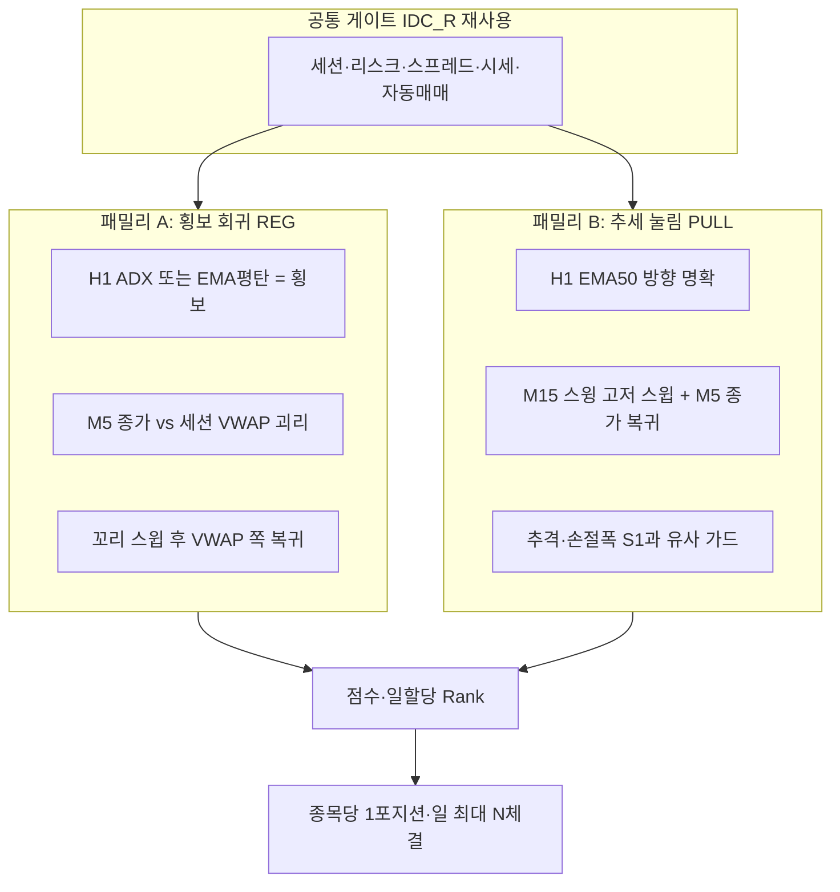

# IDC_V2 설계서 (초안 v0.2)

**전제**: `docs/EA_V2_PURPOSE.md` — **최우선 = 월 안정적 소득**. S1 폐기, IDC_R 동결.

**가칭 EA**: `IDC_V2` · 헌법 `IDC_V2_CONSTITUTION.txt` (미작성 → 구현 PR에서 동시 제출)

---

## 1. 설계 목표 요약

| 항목 | V2 목표 |
|---|---|
| **월 안정 소득** | **손실 월 비율↓**, **하위 25% 월 실수령↑**, 6개월 롤링 **CV(표준편차/중앙)** 관리 — **1순위** |
| 월 수준 | 중앙 **300만원+** (참고), **하위 25% 200만원대+** 개선 목표 |
| 일 체결 | 기대 **~2.0/세션일** (빈도는 안정 소득을 **돕는** 수준만) |
| 승률·RR | **승률 우선** **52~58%**, RR **1.2~1.5** (S3 축; 고RR 저승률 S1형 배제) |
| FTMO | IDC_R 게이트 **재사용** |

---

## 2. 핵심 아이디어: REG 중심 + 조건부 PULL

**월 안정**에는 선택표상 **승률·일 2.0회**에 가까운 **S3(회귀)** 이 S1·S2보다 유리합니다. V2는 **REG를 상시 엔진**으로 두고, **PULL은 보조**만 켭니다 (멀티종목·세션 분산으로 0건일 완화, **변동성 급증 시 학습이 PULL 가중 축소**).

- **REG (회귀, 주력 ~70% 체결 목표)**: **S3**. H1 **횡보**일 때만. 세션 VWAP 이탈 꼬리의 **복귀**. 낮은 RR, **높은 승률·꾸준한 소액 R** → 월 분산 축소.  
- **PULL (보조, ~30%)**: **S2** 축소. H1 추세 명확 시만, **점수 상위 + REG 미발동 종목**에 한정. RR 보강용이며 **최근 20거래 월간 기여 분산이 악화되면 자동 비활성** (`STAB_GATE`).

REG 단독으로도 선택표 **일 2.0**에 근접; PULL은 **안정 KPI를 해치지 않을 때만** 추가합니다.

---

## 3. 안정 소득 우선 운영 규칙

| 규칙 | 설명 |
|---|---|
| **일 체결 상한** | 기본 **3건** (과다 거래·월 분산 악화 방지). 학습 후 **2~4** |
| **하한·B-set** | **19:30 강제 완화·B-set 없음**. 0건일 허용 — **안정 > 일일 횟수** |
| **종목** | **XAUUSD, US100, EURUSD**(S3 표준), **US30** — FX·골드·지수 **상관 분산** |
| **포지션** | 종목당 1, 청산 후 재진입 허용. **동시 보유 최대 2** |
| **일 손실 후** | 당일 **2% 소프트 전** 신규는 **REG만** (PULL 자동 OFF) |
| **STAB_GATE** | 롤링 20거래 **R 표준편차**가 임계 초과 시 PULL OFF + 커트라인 **강화**(완화 금지) |

**랏**: 평균 0.30% 유지하되, **변동성 큰 PULL 후보**는 0.24% 고정, **고승률 REG**만 0.36%까지.

---

## 4. 공통 실행·리스크 (IDC_R 이식 목록)

다음 모듈은 **함수 단위 복사·리네임** 후 V2에 연결 (S1 로직은 호출하지 않음).

- `CanEnter` 게이트 체인  
- `FitLot`, `AccountFreeMarginCheck`  
- `EffPoints` / 종목 등급  
- `RiskAllowsEntry`, `SaveLearn` / `LoadLearn` (파일명 `IDC_V2_learn.txt`)  
- `LockPoints` 트레일, MFE 가상선, 90초 최소 보유  
- `FlushOx` 스타일 **패턴별** O/X (REG 8단, PULL 9단)

**SL/TP**: TP=0, SL=구조적 극값+버퍼 (패턴별 최소·최대 포인트).  
**세션 종료**: `InpCloseAtSessionEnd` 유지.

---

## 5. 학습 Layer (S1과 동일 철학, 특징량만 변경)

| 특징 | REG | PULL |
|---|---|---|
| f1 | VWAP 괴리 / ATR | M15 바 body / ATR |
| f2 | 복귀 종가 강도 | 눌림 깊이 |
| f3 | 스프레드 / 상한 | 스프레드 / 상한 |
| f4 | H1 범위폭 / ATR | H1 EMA 거리 / ATR |

- 40청산 전: REG 고정 가중치, 일 후보 **점수순**, 상한 3건  
- 40청산 후: 백분위 커트 + 랏 0.24~0.36  
- **학습 목표 함수**: 거래 R 최대화가 아니라 **롤링 60거래 R의 중앙−하위분위 차이 최소화**(안정). 로그 `STAB_LEARN`  
- **FREQ_ADJUST 삭제** — 빈도 때문에 커트 완화하지 않음

---

## 6. 선택표 대비 (왜 S3+PULL인가)

| 안 | 하루(표) | 월 중앙(표) | V2 관계 |
|---|---:|---:|---|
| S1 | 1.8 | 410 | **폐기** |
| S3 | 2.0 | 337 | **REG 뼈대** |
| S2 | 1.2 | 282 | **PULL 뼈대** |

**안정 최우선**이므로 S3 단독(+소량 PULL)이 기본. S1식 고중앙·고분산은 채택하지 않음. 멀티종목·EURUSD는 **월 CV 축소**용.

---

## 7. 검증 계획 (구현 후)

1. **Strategy Tester** — **월별 실수령 분포**, 손실 월 %, 하위 25%  
2. **포워드 4주** — 거래당 +R, **월간 R CV**, PULL ON/OFF 비교  
3. **O/X 로그** — REG/PULL 후보별 **기대 기여도** (안정 지표 악화 시 패턴 OFF)  
4. **헌법 대조** — 13항목 검수 (IDC_V2)

---

## 8. 구현 로드맵

| 단계 | 산출물 |
|---|---|
| 0 | 본 설계서 + PURPOSE (현재) |
| 1 | `IDC_V2_CONSTITUTION.txt` (REG/PULL·STAB_GATE·월 안정 KPI) |
| 2 | `MQL4/Experts/IDC_V2.mq4` — 게이트 + REG만 |
| 3 | PULL 추가 + 학습 파일 + SelfTest |
| 4 | 포워드·검수보고 |

---

## 9. 확정·남은 선택

- **확정**: 최우선 **월 안정적 소득** → REG 중심, B-set·빈도 강제 완화 **없음**.  
- **선택**: 세션 16:00–00:30 유지 vs 연장, EURUSD 포함 여부 (기본 포함).

**단계 1~2**(`IDC_V2_CONSTITUTION` + REG-only `IDC_V2.mq4`)는 위 확정안으로 진행합니다.